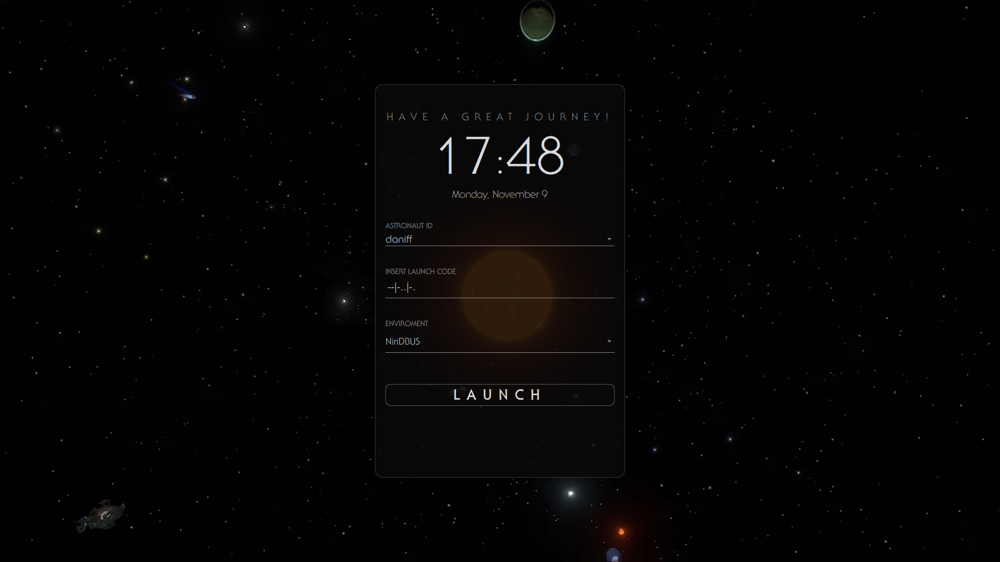

# Outer Wilds SDDM Theme

An Outer Wilds–inspired login screen for SDDM, adapted from
[Harmless Game SDDM Theme](https://github.com/neverloseagain1/Harmless-Game-SDDM-Theme).

Idea from
[MageRen](https://www.reddit.com/r/unixporn/comments/1ss6a9i/oc_outer_wilds_sddm_theme/)
(original repo is closed)

Looping video background, ITC Serif Gothic fonts, a live clock, and user and
session selectors with launch-themed labels.



## Install

Requires SDDM with Qt 6, Qt Quick Controls, and Qt Multimedia with support for
the bundled video. From this repository's directory:

```sh
sudo mkdir -p /usr/share/sddm/themes/OuterWilds
sudo cp -r Main.qml metadata.desktop theme.conf preview.png backgrounds fonts /usr/share/sddm/themes/OuterWilds/
```

Set the theme in `/etc/sddm.conf.d/theme.conf` (create the directory if needed):

```ini
[Theme]
Current=OuterWilds
```

## Customize

Set `videoVolume` in `theme.conf` between `0` (muted) and `1`.
Colors and fonts are defined in `Main.qml`; the background video is
`backgrounds/OuterWilds_new.mkv`.

## Preview

Run from this repository's directory without logging out:

```sh
sddm-greeter-qt6 --test-mode --theme .
```

Some distributions name the Qt 6 executable `sddm-greeter`.

Unofficial fan theme; not affiliated with Mobius Digital or Annapurna Interactive.
See [LICENSE](LICENSE).
